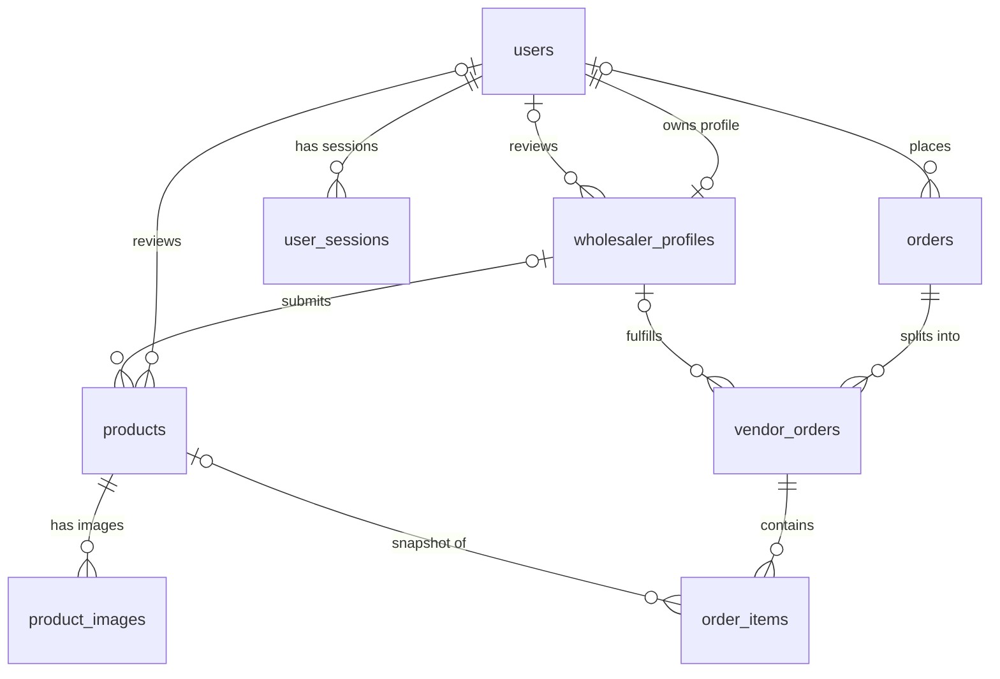

# D1 schema contract

The storefront D1 database is the current source of truth for the catalog and account schema. The numbered SQL migrations in [`apps/storefront/migrations/`](../../storefront/migrations/) are authoritative and are applied with Wrangler. Do not edit a migration that has already been applied; add a new numbered migration instead. Frontend code should use application routes rather than connecting to D1 from the browser.

## Accounts

- `users`: unique case-insensitive `email`, `password_hash`, `role` (`admin`, `customer`, `wholesaler`), account `status`, and timestamps. Store a password hash only, never a password.
- `wholesaler_profiles`: one profile per user, business/contact details, moderation `status` (`pending`, `active`, `rejected`, `suspended`), reviewer and rejection fields.
- `user_sessions`: user reference, unique `token_hash`, expiry, and optional revocation timestamp. Store a hash of the session token, not the token itself.
- `orders`: customer and delivery snapshots, order/payment status, currency and totals. `user_id` is nullable for the transition from the current guest checkout to authenticated checkout.
- `vendor_orders`: fulfillment sub-order for each seller inside a customer order. `seller_name_snapshot` preserves the seller display name if the profile later changes.
- `order_items`: product, name, slug, unit-price and quantity snapshots. Historical order lines survive product deletion.

Public signup may create customers and wholesaler accounts, but must never grant the `admin` role. Admin accounts need a trusted provisioning path. A wholesaler must have an active profile before submitting products.

## Catalog moderation

`products.wholesaler_id` points to the submitting wholesaler profile. It is nullable for the existing seeded catalog. `products.status` is one of `draft`, `pending_review`, `approved`, `rejected`, or `archived`; only approved and published products belong in the public catalog. `reviewed_by`, `reviewed_at`, and `rejection_reason` record the latest moderation decision.

The existing `published` field remains for compatibility. New moderation and vendor routes should keep it consistent with `status`; public catalog queries must check both.

## Tables and relationships

| Table | Purpose | Main fields |
| --- | --- | --- |
| `users` | Login identity and global role | `id`, `email`, `password_hash`, `role`, `status`, `email_verified_at`, timestamps |
| `wholesaler_profiles` | Business details and admin approval | `id`, `user_id`, `business_name`, contact/address fields, `status`, `reviewed_by`, `reviewed_at`, `rejection_reason` |
| `user_sessions` | Revocable, expiring login sessions | `id`, `user_id`, `token_hash`, `expires_at`, `revoked_at`, `created_at` |
| `products` | Catalog entries and moderation state | Product details, `supplier_price_cents`, `price_cents`, stock flags, `wholesaler_id`, `status` and review fields |
| `product_images` | Ordered image URLs for a product | `id`, `product_id`, `image_url`, `position` |
| `orders` | Customer's complete purchase request | Customer identity, delivery snapshot, status, payment status and integer-cent totals |
| `vendor_orders` | Seller-specific part of an order | `order_id`, optional `wholesaler_profile_id`, seller-name snapshot and fulfillment status |
| `order_items` | Products and quantities purchased | Product reference plus product-name, slug and price snapshots |

The `role` on `users` identifies the account type. A wholesaler's `wholesaler_profiles.status` separately represents business approval; being signed in as a wholesaler does not mean the shop has been approved.

An `orders` row represents the customer's full order. Its `vendor_orders` split fulfillment by seller, and each sub-order contains its `order_items`. Existing seeded products have no wholesaler profile, so the seller is recorded in `seller_name_snapshot` and `wholesaler_profile_id` may be null. All prices and totals stored in D1 are integer euro cents (`*_cents`); never use floating-point values for stored money or order totals. The storefront API converts catalog prices to euros for display. D1 stores no card number or security code.

## Current scope

The account/session tables define the D1 contract, but registration, login, session validation, wholesaler submission, moderation, and order-creation routes still need implementation. Payment provider records and payment processing are not part of this migration; the order starts as unpaid. The D1 schema currently has no `categories` table; product category is stored as text in `products.category`.

## PostgreSQL archive

[`postgres_schema.legacy.sql`](postgres_schema.legacy.sql) is the previous PostgreSQL schema, retained only because the separate FastAPI/Alembic migration still references it. It is not the D1 schema and must not be used to change the Cloudflare database.
